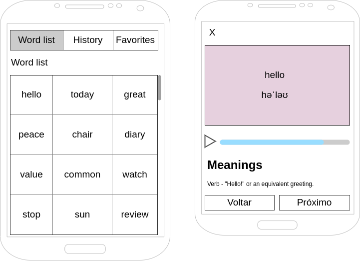

# Dictionary — Mobile Challenge

Aplicativo React Native (Expo) para explorar ~370 mil palavras em inglês com rolagem infinita, ver significados, fonética e pronúncia pela [Free Dictionary API](https://dictionaryapi.dev/), e gerenciar favoritos e histórico por usuário.

> This is a challenge by [Coodesh](https://coodesh.com/)

O enunciado original do desafio está em [`docs/CHALLENGE.md`](docs/CHALLENGE.md).

<p align="center"></p>

---

## Tecnologias

- **Linguagem:** TypeScript
- **Framework:** React Native 0.88 + [Expo SDK 58](https://docs.expo.dev/) (roda no **Expo Go**, sem build nativo)
- **Navegação:** Expo Router (rotas por arquivo, `Stack.Protected` para rotas autenticadas)
- **UI / Estilização:** React Native Paper (Material Design 3), tema claro e escuro
- **Gestão de dados:** SQLite (`expo-sqlite`) + Context API
- **Back-end:** SQLite local (padrão) **ou** Supabase (Auth + Postgres com RLS), escolhido por variável de ambiente
- **Áudio:** `expo-audio` (gravação da pronúncia) com fallback para `expo-speech` (voz sintetizada nativa)
- **Injeção de dependência:** tsyringe
- **Segurança:** PBKDF2-SHA256 (`@noble/hashes`) para senhas, `expo-secure-store` para a sessão
- **Testes:** Jest (`jest-expo`) + React Native Testing Library + sql.js (SQLite real em WebAssembly)
- **Qualidade:** ESLint (`eslint-config-expo`), TypeScript `strict`

---

## Como instalar e usar

### Pré-requisitos

- Node.js 20+ e npm
- App **Expo Go** no celular (Android/iOS) **ou** um emulador Android / simulador iOS

### Rodando

```bash
git clone https://github.com/lucasbachega/dictionary-mobile-test.git
cd dictionary-mobile-test
npm install
npx expo start
```

Escaneie o QR Code com o Expo Go (Android) ou com a câmera (iOS), ou pressione `a` / `i` para abrir no emulador.

Na **primeira execução** o app baixa o `words_dictionary.json` (≈6,8 MB) e salva as palavras no SQLite do aparelho — isso leva alguns segundos e precisa de internet. Depois disso a lista funciona offline.

Crie uma conta na tela inicial (e-mail + senha) e pronto.

### Scripts

| Comando | O que faz |
| --- | --- |
| `npm start` | Inicia o Metro / Expo |
| `npm test` | Roda os 53 testes unitários e de componentes |
| `npm run typecheck` | Checagem de tipos (`tsc --noEmit`) |
| `npm run lint` | ESLint |

### (Opcional) Usando o Supabase como back-end

Por padrão tudo fica no SQLite do aparelho. Para salvar usuários, favoritos e histórico no Supabase:

1. Crie um projeto em [supabase.com](https://supabase.com/).
2. No **SQL Editor**, rode o arquivo [`supabase/schema.sql`](supabase/schema.sql) (tabelas + políticas RLS).
3. Copie `.env.example` para `.env` e preencha `EXPO_PUBLIC_SUPABASE_URL` e `EXPO_PUBLIC_SUPABASE_ANON_KEY` (em *Project Settings → API*).
4. Reinicie com `npx expo start --clear`.

Se o projeto exigir confirmação de e-mail, o app avisa após o cadastro para confirmar antes de entrar.

---

## Funcionalidades x requisitos

| Requisito | Como foi atendido |
| --- | --- |
| **Obrigatório 1** — lista com rolagem infinita | Aba *Word list*: grade de 3 colunas paginada por cursor no SQLite (60 por página), com busca por prefixo |
| Ver palavra, significados e fonética | Tela de detalhe: card com palavra + fonética, seção *Meanings* (classe gramatical, definição, exemplo, sinônimos) |
| Salvar / remover favorito | Coração no topo da tela de detalhe (atualização otimista com rollback) e aba *Favorites* |
| Lista de palavras já vistas | Aba *History*, da mais recente para a mais antiga, com opção de limpar |
| Lista de palavras do GitHub | `words_dictionary.json` do repositório `dwyl/english-words`, baixado e salvo no SQLite |
| **Obrigatório 2** — cache das requisições | Cache em memória + SQLite, com TTL, deduplicação e fallback offline (detalhes abaixo). Um chip "cache" aparece quando a resposta veio do cache |
| **Obrigatório 3** — wireframe | Abas *Word list / History / Favorites*, grade 3 colunas; detalhe com `X`, card rosa, play + barra de progresso, *Meanings*, botões *Voltar / Próximo* |
| **Diferencial 1** — áudio | Toca o mp3 da API com progresso real; sem gravação, usa a voz sintetizada do sistema |
| **Diferencial 2** — DI | tsyringe; telas dependem só das interfaces do domínio |
| **Diferencial 3** — testes | 53 testes (Jest + RNTL) cobrindo repositórios com SQLite real, cache, hooks e telas |
| **Diferencial 4** — login | Cadastro/login com e-mail e senha; favoritos e histórico ligados ao `user_id` (SQLite local ou Supabase) |
| Validação de chamadas assíncronas | Timeout com `AbortController`, descarte de respostas obsoletas, sem `setState` após desmontar, estados de loading/erro/vazio com "Tentar novamente" |

---

## Arquitetura

Organização em camadas inspirada em Clean Architecture — as dependências apontam sempre para dentro (`presentation → domain ← data`):

```
src/
├── app/                  # Rotas (Expo Router) — só reexportam as telas
├── core/                 # Infra transversal: config, DI (tsyringe), erros, fetch com timeout
├── domain/               # Entidades, contratos dos repositórios e validações (sem dependência de libs)
├── data/                 # Implementações: SQLite, Free Dictionary API, Supabase, cache, hash de senha
│   ├── database/         #   interface SqlDatabase + migrações versionadas (PRAGMA user_version)
│   ├── datasources/      #   API do dicionário, download da lista de palavras, cache persistente
│   ├── mappers/          #   resposta da API → entidade WordDetails
│   └── repositories/     #   SQLite (local) e Supabase (remoto)
└── presentation/         # Telas, componentes, hooks e providers (Context API)
test/                     # Adaptador sql.js, providers e fixtures de teste
supabase/schema.sql       # Schema + RLS do back-end opcional
```

### Fluxo de inicialização

1. `BootstrapGate` abre o SQLite e roda as migrações.
2. Registra as dependências no container (`registerDependencies`) — local ou Supabase, conforme o `.env`.
3. Se for a primeira execução, importa a lista de palavras.
4. `AuthProvider` restaura a sessão; `Stack.Protected` decide entre login e app.

---

## Processo e decisões

### 1. Lista de palavras (370 mil itens)

**Problema:** a API não tem endpoint de listagem; o arquivo indicado tem ~370 mil chaves (6,8 MB).

**Opções avaliadas:**
- Embutir o JSON no bundle → aumenta o app em ~7 MB e o `require` de um JSON gigante custa memória e tempo de inicialização no Hermes.
- Manter tudo em memória → simples, mas ~370 mil strings ficam vivas o tempo todo e a busca vira `filter` linear.
- **Baixar uma vez e salvar no SQLite (escolhida)** → memória baixa, paginação e busca indexadas, funciona offline depois da primeira vez. O enunciado também sugere salvar em banco local.

**Importação rápida:** em vez de 370 mil `INSERT`s pela ponte JS → nativo, o JSON inteiro é enviado como **um único parâmetro** e o próprio SQLite o percorre com `json_each`:

```sql
INSERT OR IGNORE INTO words (word)
SELECT lower(trim(key)) FROM json_each(?);
```

Nos testes (SQLite em WebAssembly, mais lento que o nativo) o arquivo real inteiro é importado em ~0,5 s. Se a build do SQLite não tiver JSON1, há um fallback com inserts em lotes de 500 dentro de uma transação. A importação só é marcada como concluída depois de salvar tudo (se falhar no meio, recomeça na próxima abertura).

**Paginação:** keyset (`WHERE word > :cursor ORDER BY word LIMIT n`) em vez de `OFFSET`. A tabela é `WITHOUT ROWID` com a palavra como chave primária, então cada página é uma busca O(log n) no índice — a página 6.000 é tão rápida quanto a primeira. A mesma consulta resolve a busca por prefixo (`word >= 'hel' AND word < 'hel￿'`) e o *Voltar/Próximo* (vizinho anterior/seguinte em ordem alfabética).

**Rolagem:** `FlatList` com `numColumns={3}`, `getItemLayout` (altura fixa), `removeClippedSubviews` e janela de renderização reduzida. O hook `useInfiniteWords` ignora disparos repetidos de `onEndReached` enquanto uma página carrega e descarta respostas de buscas antigas.

### 2. Cache das requisições (Obrigatório 2)

`CachedDictionaryRepository` resolve uma palavra nesta ordem:

1. **Memória** (`Map`) → navegar com Voltar/Próximo por palavras já vistas é instantâneo.
2. **SQLite** (`word_cache`) → sobrevive ao fechamento do app.
3. **API**, com:
   - **deduplicação**: chamadas simultâneas para a mesma palavra compartilham a mesma `Promise`;
   - **TTL**: 30 dias para palavras encontradas, 1 dia para "não encontrada" (404 também é cacheado — muitas palavras da lista não existem na API, e sem isso cada visita repetiria a requisição);
   - **fallback offline**: se a rede falhar e houver cache expirado, ele é exibido em vez de erro.

Falhar ao *gravar* o cache nunca impede o usuário de ver a palavra.

### 3. Chamadas assíncronas sem travamentos

- `fetchWithTimeout`: toda requisição tem timeout (10 s para a API, 60 s para o download da lista) via `AbortController`, com erros normalizados em `AppError` e mensagens em português.
- Os hooks guardam junto com o resultado a qual palavra/tentativa ele pertence; respostas que chegam fora de ordem (ex.: tocar *Próximo* várias vezes rápido) são ignoradas.
- Nenhum `setState` depois de desmontar (flags `active` nos efeitos).
- O hash de senha usa `pbkdf2Async`, que cede o event loop e não congela a UI.
- Formulários bloqueiam duplo envio; toda tela tem estados de carregamento, vazio e erro com "Tentar novamente".

### 4. Voltar / Próximo e o histórico

Abrir uma palavra a move para o topo do histórico. Se *Voltar/Próximo* navegasse pela lista "viva", o *Próximo* pularia itens. Por isso `useWordNavigation` tira um **snapshot** da lista de origem (History ou Favorites) ao abrir o detalhe, e só depois a visualização é registrada. Para a *Word list*, os vizinhos vêm direto do índice alfabético do SQLite.

### 5. Áudio (Diferencial 1)

A API traz URLs de mp3 em `phonetics[].audio` (às vezes vazias ou sem protocolo, como `//ssl.gstatic.com/...`). O mapper normaliza as URLs e prioriza o sotaque americano (`-us.mp3`). O player usa `expo-audio` com barra de progresso real. Quando não há gravação, o mesmo botão usa `expo-speech` (TTS nativo, `en-US`) — assim toda palavra tem pronúncia. Escolhi recursos nativos em vez do ResponsiveVoice por não depender de chave/serviço externo e funcionar no Expo Go.

### 6. Autenticação e back-end (Diferencial 4)

O enunciado lista Firebase/Supabase como back-end, mas exigir um projeto remoto tornaria o app impossível de avaliar sem credenciais. A solução foi **as duas coisas**, atrás das mesmas interfaces:

- **Local (padrão):** tabela `users` no SQLite; senha com PBKDF2-SHA256 + salt aleatório (`expo-crypto`), comparação em tempo constante; ID da sessão no Keychain/Keystore (`expo-secure-store`). Login com e-mail inexistente ou senha errada retorna a mesma mensagem (não revela quais e-mails existem).
- **Supabase:** Supabase Auth + tabelas `favorites` / `history` com Row Level Security (cada usuário só acessa os próprios registros).

Favoritos e histórico sempre são gravados com o `user_id`. A lista de palavras e o cache do dicionário continuam locais nos dois modos, porque são dados do aparelho, não do usuário.

### 7. Injeção de dependência (Diferencial 2)

`core/di/container.ts` registra tudo no tsyringe com factories singleton (sem decorators, que exigiriam plugins extras do Babel). A escolha local/Supabase acontece em um único lugar. Telas e hooks pedem dependências por token via `useDependency`, e o container chega por Context — nos testes, cada caso cria um container filho e troca o que quiser por fakes.

### 8. Testes (Diferencial 3)

Optei por testes **unitários e de componentes** (Jest + React Native Testing Library) em vez de E2E (Detox/Maestro): rodam em segundos, sem emulador, e cobrem a lógica que mais importa.

O destaque é o `test/SqlJsDatabase.ts`: os repositórios dependem de uma interface `SqlDatabase` (subconjunto da API do `expo-sqlite`), então nos testes eles rodam contra **SQLite real compilado para WebAssembly** (sql.js). Assim as queries, migrações, paginação e o `json_each` são testados de verdade, não mockados.

Cobertura principal:
- **Repositórios:** importação e paginação da lista, busca, vizinhos, favoritos/histórico isolados por usuário, cadastro/login (hash, e-mail duplicado, senha errada).
- **Cache:** hit em memória, persistência entre "reinícios", 404 cacheado, deduplicação, TTL, fallback offline, `forceRefresh`.
- **API / rede:** URL, 404, 5xx, timeout com `AbortController`.
- **Hooks:** rolagem infinita sem páginas duplicadas, troca de filtro, favorito otimista com rollback, snapshot do histórico.
- **Telas:** listagem e troca de abas, detalhe (fonética, significados, favoritar, *Próximo*, palavra sem definição), validação do formulário de login.

### 9. UI / Usabilidade

- Segui o wireframe: abas no topo, título da seção, grade 3 colunas com bordas; detalhe com `X`, card rosa, player, *Meanings* e *Voltar/Próximo* fixos no rodapé.
- Acréscimos que não mudam o layout: busca por prefixo, contador de itens, coração de favorito no topo do detalhe, chip "cache", limpar histórico com confirmação, Snackbar de feedback.
- Material 3 com tema claro/escuro automático, áreas de toque ≥ 48 dp, `accessibilityLabel` nos botões de ícone, textos longos se ajustam à célula.
- A lista principal continua montada ao trocar de aba, preservando a posição da rolagem.

### Limitações conhecidas / próximos passos

- Na primeira execução é preciso internet para baixar a lista de palavras.
- No modo Supabase, favoritos/histórico exigem conexão (não há fila offline de sincronização).
- Testes E2E (Maestro) seriam um bom complemento para validar o fluxo completo num dispositivo.
